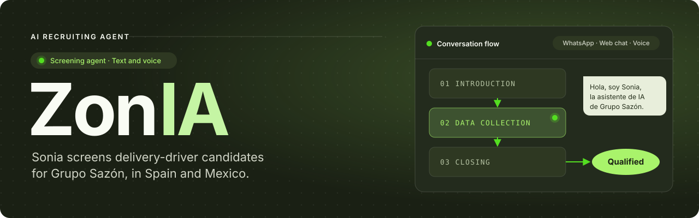
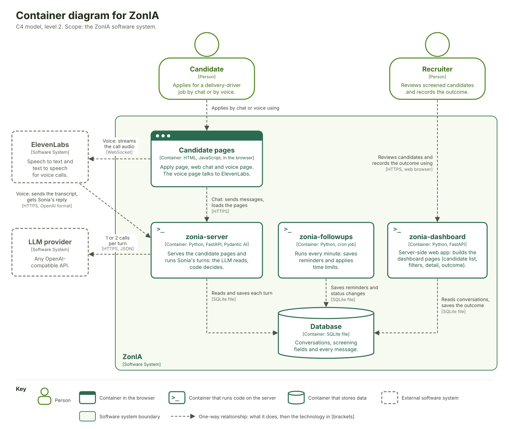

<p align="center">
  
</p>

Sonia is an AI agent that screens delivery-driver candidates for Grupo Sazón, a restaurant chain in Spain and Mexico. She talks with each candidate by text or by voice, collects the screening data, checks the hard requirements, and leaves a summary for the recruiter.

## Try the demo

You need three things:

- Python 3.12 or newer.
- [uv](https://docs.astral.sh/uv/), the Python package manager.
- An API key for an LLM with an OpenAI-compatible endpoint, for example a [Gemini API key](https://aistudio.google.com/apikey).

Steps:

1. In the project folder, install the dependencies: `uv sync`.
2. Create a file `.env` in the project folder with these two lines:

   ```text
   ZONIA_BASE_URL=https://generativelanguage.googleapis.com/v1beta/openai/
   ZONIA_API_KEY=<your API key>
   ```

3. Start the candidate side: `uv run zonia-server`.
4. In a second terminal, start the recruiter dashboard: `uv run zonia-dashboard`.
5. Open http://127.0.0.1:8001/apply. This is a mock job page.
6. Choose the country: España or México. The phone field fills in a test number for that country.
7. Click "Por chat".
8. Chat with Sonia as a candidate.
9. Open http://127.0.0.1:8000 to see the candidate as the recruiter sees them: the status, the data and the summary.

### Voice (optional)

Voice needs an [ElevenLabs](https://elevenlabs.io/) agent and a public address for the server. ElevenLabs turns speech into text, calls Sonia's server, and turns her reply into speech.

1. Add three lines to `.env`. `ELEVENLABS_AGENT_ID` is the id of the ElevenLabs agent. `ELEVENLABS_LLM_KEY` is a secret you make, for example with `openssl rand -hex 32`. `ZONIA_PUBLIC_URL` is the server's public address, for example `https://<name>.ngrok-free.dev`.
2. Give the server that public address, for example `ngrok http 8001 --url=<public address>`.
3. In the ElevenLabs agent, choose the "custom LLM" option and set its URL to `<public address>/voice`.
4. Add the value of `ELEVENLABS_LLM_KEY` as the agent's API key secret.
5. In the agent's security settings, allow overrides of the first message and of the custom LLM extra body.
6. Publish the agent. Calls use the published version, not the draft.
7. Restart `uv run zonia-server`.
8. On http://127.0.0.1:8001/apply, choose the country and click "Por voz".

Before each call, the server checks that its public address reaches it. If not, the call does not start and the server log says why.
With `ELEVENLABS_API_KEY` in `.env` (an ElevenLabs API key that can read agents), it also checks that the agent's custom LLM URL is `<public address>/voice`.

## For developers

### Commands

| Command | What it does |
|---|---|
| `uv run zonia` | Chat with Sonia in the terminal. `uv run zonia <id>` continues a saved conversation. |
| `uv run zonia-followups` | Checks every open conversation once and does the step that is due: a reminder, paused or incomplete. The reminder is saved in the conversation, and the web chat shows it when the candidate opens the chat again. It is not sent on any channel yet. In production a scheduler (for example cron) runs it every minute. |
| `uv run pytest` | The unit tests. A stub replaces the LLM: it returns scripted replies, so the tests need no API key and no network. |
| `uv run python evals/run.py` | The evals: 37 scripted conversations with the real LLM. See [evals/README.md](evals/README.md). |
| `uv run python evals/samples.py` | Writes the sample conversations in [deliverables/sample-conversations/](deliverables/sample-conversations/). |

### Variables in `.env`

| Variable | Needed by | What it is |
|---|---|---|
| `ZONIA_BASE_URL` | every command that calls the LLM | An OpenAI-compatible endpoint. |
| `ZONIA_API_KEY` | same | The API key of that provider. |
| `ZONIA_DB` | optional | Another SQLite database file. Without it, the server uses `zonia.db` in the project folder. |
| `ZONIA_COUNTRY` | optional, `zonia` only | `ES` (Spain) or `MX` (Mexico) for a new terminal chat. Default: `ES`. |
| `ELEVENLABS_AGENT_ID`, `ELEVENLABS_LLM_KEY` | optional, voice | See [Voice (optional)](#voice-optional). |
| `META_APP_SECRET`, `META_VERIFY_TOKEN`, `META_WHATSAPP_TOKEN`, `META_PHONE_NUMBER_ID` | optional | Meta's WhatsApp Cloud API. The WhatsApp channel is not finished. Without these variables, the server starts without it. |

### Sonia's prompt

Sonia's model, its settings and her system prompt are in `src/zonia/agent/sonia.yaml`, a [Pydantic AI agent spec](https://ai.pydantic.dev/agent-spec/).
Its `metadata.version` names the prompt: each message Sonia writes saves it, for example `sonia@1`.
A test makes sure the prompt version is right: if you change any text the LLM reads, `tests/test_prompt_version.py` fails until you raise `metadata.version` in `sonia.yaml`.

## Architecture



- **One core, many channels.** Each channel has an adapter. The adapter gives the candidate's text to the core and sends the reply back on the same channel. The core does not know the channel.
- **The LLM reads, code decides.** In each turn the LLM returns the extracted fields, the candidate's intent and a reply ([src/zonia/agent/turn.py](src/zonia/agent/turn.py)). Code then checks the values ([src/zonia/domain/validation.py](src/zonia/domain/validation.py)) and decides the stage and the status ([src/zonia/domain/flow.py](src/zonia/domain/flow.py)).
- **A second LLM call only when needed.** When the status changes, or a value is not valid, a second call writes the reply again with a directive. Code writes the summary, so the data in it is exact.
- **Stages:** `introduction`, `data_collection`, `closing`.
- **Statuses:** `active`, `paused`, `qualified`, `disqualified`, `withdrawn`, `incomplete`, and `technical_error` after 2 failed turns in a row. `technical_error` is not final: a good turn makes the conversation `active` again. The dashboard highlights it, so the recruiter contacts the candidate.
- **Structured data:** the screening fields are one Pydantic model, `ScreeningFields` ([src/zonia/domain/models.py](src/zonia/domain/models.py)). The LLM fills it in each turn, and it is saved as JSON.
- **Storage:** SQLite keeps each conversation, its data as JSON and every message, so the full history is kept. The recruiter reads it in the dashboard.

## Key decisions

1. **Ports and adapters.** All conversation logic is in one core. To add a channel, you write an adapter, and the core does not change.
2. **Text first.** 60% of candidates do not answer phone calls, and WhatsApp is the main messaging app in Spain and Mexico. So the main channel is written messages. A web chat gives the same experience for the demo.
3. **Voice in the browser through ElevenLabs.** ElevenLabs handles speech. Sonia's server stays the only "brain", so voice follows the same flow and the same checks as text.
4. **Business settings are configuration, not code.** Service zones, the job facts Sonia may share, the greeting, the turn limit, the follow-up times and the contact emails are in [src/zonia/config.py](src/zonia/config.py). Sonia's personality is in [src/zonia/agent/sonia.yaml](src/zonia/agent/sonia.yaml).
5. **Sonia answers only from the job facts.** Her prompt tells her to use only the job facts and to say when she does not have the information. An LLM can still invent facts, so the evals check every conversation for invented facts (rule `no_inventa` in `evals/personas.py`).
6. **A narrow context keeps Sonia safe.** Sonia's LLM sees only what the current candidate needs: her prompt, the job facts and that candidate's own conversation. It has no tools, no database access and no private data, so a prompt injection has nothing to reach.
7. **Spanish and English, with each country's words.** Sonia replies in the candidate's language. In Spain she says "carné de conducir" and "barrio"; in Mexico, "licencia de manejo" and "colonia".
8. **A person can always review.** A disqualified candidate gets a contact email and a case code to ask for a human review.

## Improvements

Sonia handles the normal flow well. These are the next steps, grouped by topic.

**Conversation.** Some edge cases still need work.
- Keep the corrections made at the summary. Today a changed availability can be lost, and a corrected zone can be marked as outside the service area.
- Ask what the candidate means when they say the data was for another person ("esto era para mi hermano"). Today Sonia reads it as a withdrawal and closes the application.
- Stay inside the job facts after a final status. In one test Sonia gave opinions and invented company facts.
- Answer "why do you want my data?", and do not read the list of zones to a disqualified candidate.
- Move on after 2 failed tries by marking the field "needs review", and warn the candidate before the limit of 60 messages.
- When cheating is suspected, tell the candidate that a person makes the final decision.

**Privacy and the recruiter.**
- Add a login to the dashboard. Today anyone who can reach port 8000 sees every candidate.
- Delete an application when the candidate asks, as GDPR requires. Today Sonia only says goodbye.
- Keep a log of events, so the recruiter sees what changed in each conversation (for example, the zone).
- Give the recruiter tools in the dashboard: a status (called, interview, hired, rejected), notes, CSV export, one recruiter per candidate, and interview scheduling.

**Reliability.**
- Save the candidate's message before the LLM call, so a crash does not lose it.
- Make a failed turn cheaper. Today it can send up to 12 calls to Gemini and take about 45 seconds.

**Channels and languages.**
- Send the reminders on the candidate's channel. Today `zonia-followups` only saves them in the conversation.
- Finish WhatsApp: the adapter is written, but it is not tested with real messages. Then accept voice notes and locations.
- Make voice calls smoother: handle silence and filler sounds ("...", "Eh") without an LLM call and without hurrying the candidate, end the call after a long silence, and replace "Espero que escribas" with a phrase that fits a call.
- Consider other languages of Spain and Mexico, such as Catalan or Nahuatl.

**Evals.** Make the judge (the LLM that checks the rules) more exact. Today it marks some correct replies as failures and misses some real problems.

## Deliverables

- [Process design document](deliverables/process-design.html): stages, fields and validation, outcomes, edge cases, personality, and message tone. Download it and open it in a browser.
- [Sample conversations](deliverables/sample-conversations/README.md): 11 conversations played against the real LLM, shown as a phone chat. 7 follow the normal flow, and 4 are simulated difficult candidates. Open `index.html` in that folder in a browser.
